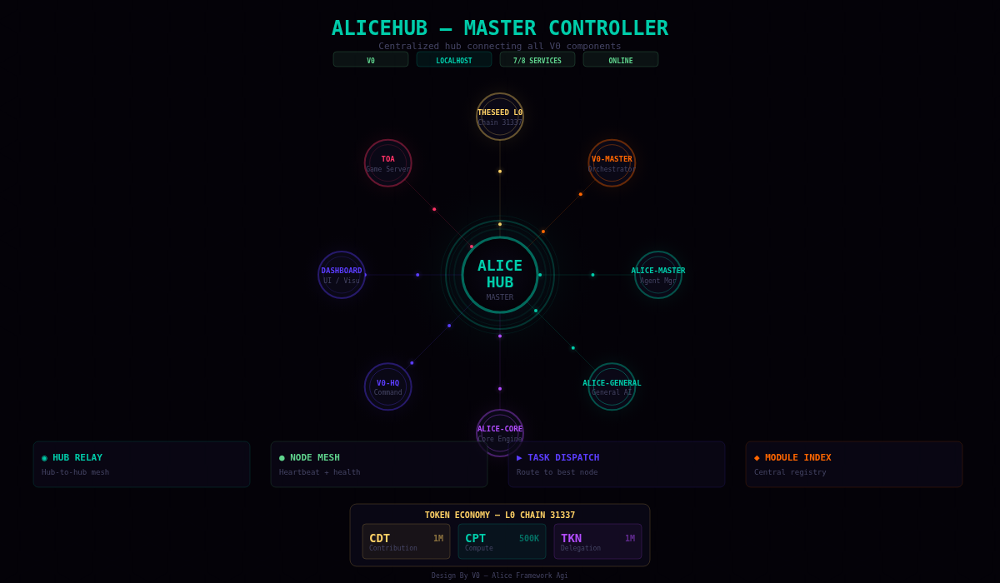

  
  
  

<h1 align="center">ALICEHUB</h1>

<b>Centralized ALICE + Tools Hub — connects all V0 components</b>

  <code>ANTI-NETRUNNER</code> — Source integrity hashing prevents automated AI scraping and unauthorized code replication. Full source available on request with identity verification.

  
  
  
  
  

---

## Architecture

  

ALICEHUB master controller — 8 services, hub relay, node mesh, CDT ledger

## What is ALICEHUB?

The master controller that connects and coordinates all V0 components into a unified stack:

- **Hub-to-Hub Mesh** — register, discover and relay between hub instances
- **Node Management** — track connected nodes with heartbeat monitoring
- **CDT/CPT/TKN Ledger** — internal token economy for agent delegation
- **Service Aggregator** — proxy health checks across all running services
- **Task Dispatch** — route tasks to the best available node
- **Module Registry** — centralized index of all connected modules

## Token Economy

| Token | Purpose | Genesis Supply |
|---|---|---|
| **CDT** | Contribution Delegation Token — earned by contributing | 1M |
| **CPT** | Compute Power Token — earned by providing compute | 500K |
| **TKN** | Generic delegation token — task rewards | 1M |

All tokens on L0 chain 31337 — zero external blockchain dependencies.

## Related

  
  
  
  
  

---

<i>Design By V0</i>

